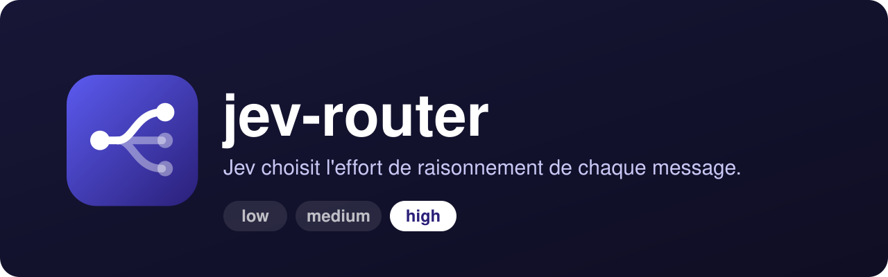
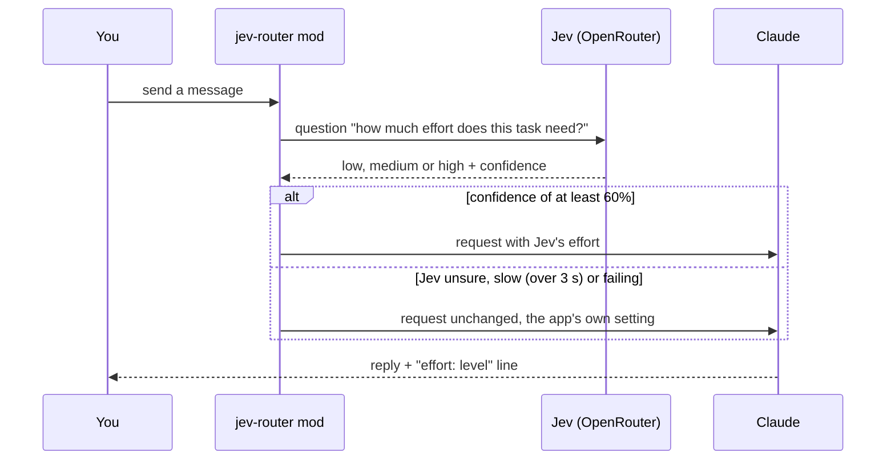

<div align="center">

[](README.md)


# jev-router

**Jev picks the reasoning effort of each message you send to Claude Code.**<br>
Small tasks run at `low`, big ones at `high`, with no manual effort setting to juggle.

[](LICENSE)
[](#install)
[](hooks/register.tsx)
[](https://openrouter.ai)
[](https://openrouter.ai/typesafe/jev-1.13)

</div>

<p align="center"></p>

## Why

Reasoning effort is set once for the whole session. Too high, and "rename this variable" gets as much thinking as a full refactor. Too low, and the refactor is rushed. Switching models per message is no answer either: it drops the prompt cache.

jev-router lets **Jev** (TypeSafe System One, `typesafe/jev-1.13` on OpenRouter) decide for you, message by message, on the same model. Created with Claude.

## How it works



- **One question per message.** Jev gets one `choice` question (`low`, `medium`, `high`): about 0.5 s and a fraction of a cent.
- **60% confidence threshold.** Below it, the app's own effort setting stays.
- **The model is never switched.** A model change drops the prompt cache, an effort change keeps it.
- **A band above the prompt** shows Jev's pick, its confidence and the effort actually used, with buttons to pin an effort (`low`, `medium`, `high`), turn Auto off, or unpin.
- **An `effort : <level>` line** appears under each reply.
- **Left alone:** subagents, slash commands and messages shorter than 8 characters. If Jev takes more than 3 s or fails, the message goes through unchanged.

## Install

```sh
curl -fsSL https://raw.githubusercontent.com/pyxl-dev/jev-router/main/install.sh | sh
```

The installer adds the `pyxl-dev/jev-router` marketplace to Claude Code, installs the mod, then checks whether an OpenRouter key is already in the Keychain. Re-run it to update; `--uninstall` removes the mod and the marketplace. It only touches your Claude Code configuration.

Without the script, three equivalent ways:

```sh
# inside Claude Code
/plugin install jev-router --marketplace pyxl-dev/jev-router

# or from a shell
claude plugin marketplace add pyxl-dev/jev-router
claude plugin install jev-router@jev-router
```

In the desktop app: **+**, **Plugins**, **Add marketplace** (`pyxl-dev/jev-router`), **Add plugin**.

### Let your AI agent do it

Paste this into Claude Code, Codex, Cursor or any agent with terminal access:

```text
Install jev-router: https://github.com/pyxl-dev/jev-router
Follow the AGENTS.md file in that repository.
```

[`AGENTS.md`](AGENTS.md) tells the agent how to install it, how to handle the key, and the safety rules (never ask for your key in chat).

### API key

You need an OpenRouter key with some credit. Two ways to provide it:

- in the plugin's `OpenRouter API key` option at install time (kept in secure storage), or
- on macOS, with the option left empty, by putting the key in the Keychain yourself:

```sh
security add-generic-password -U -a "$USER" -s openrouter-jev -w
```

Without a key the mod stays silent.

### Requirements

| | Used for |
| --- | --- |
| [Claude Code](https://claude.com/claude-code) (CLI or desktop app) | hosting the mod |
| An [OpenRouter](https://openrouter.ai) account with credit | calling Jev |
| macOS (optional) | reading the key from the Keychain (`openrouter-jev`) |

## Usage

Nothing to run: send your messages as usual.

- The band "Jev: `high` 87% · used: `high`" shows above the prompt. Below 60% confidence it adds "(pas sûr)" (not sure) and the app's effort stays. The band's labels are in French.
- Click `low`, `medium` or `high` to **pin** an effort: it wins over Jev until you click it again or press **Désépingler** (unpin).
- **Auto: on / off** turns Jev's picks on or off (a pinned effort still applies).

### Decision log

Each message Jev rated writes one JSON line to `~/.claude/jev-router/decisions/<YYYY-MM>/<session id>.jsonl`, once its turn ends:

- `at`, `prompt` (first 200 characters)
- `jev`: Jev's pick, confidence and latency (`null` when Jev failed or was too slow)
- `pinned`, `auto`, `appEffort` (the app's own setting) and `effort` (what actually ran)
- `model`, `inputTokens`, `outputTokens` (thinking included), `durationMs`, `aborted`

To see how often each effort ran and how much output it cost on average:

```sh
cat ~/.claude/jev-router/decisions/*/*.jsonl | jq -s 'group_by(.effort) | map({effort: .[0].effort, turns: length, avgOutput: (map(.outputTokens // 0) | add / length | round)})'
```

The log stays on your machine.

## Security and privacy

- **Every prompt you send (first 4000 characters) goes to OpenRouter and TypeSafe to be rated.** Don't use this mod in sessions where your prompts must stay on your machine.
- The key is read once per load and never shown.
- The decision log is local and keeps only the first 200 characters of each prompt.

## Development

```sh
git clone https://github.com/pyxl-dev/jev-router && cd jev-router
claude plugin marketplace add ./   # add this clone as a marketplace
claude plugin install jev-router@jev-router
```

The log test (`hooks/log.test.ts`) imports `claude-code/testing`.

| File | |
| --- | --- |
| `hooks/register.tsx` | the mod: Jev call, effort choice, band, label under replies, log |
| `hooks/hooks.json` | declares the module to load |
| `hooks/log.test.ts` | decision log test |
| `types/index.d.ts` | types for the plugin state and a log line |
| `.claude-plugin/plugin.json` | plugin manifest and the `OpenRouter API key` option |
| `.claude-plugin/marketplace.json` | the `pyxl-dev/jev-router` marketplace |
| `docs/logo.svg`, `docs/banner.svg` | logo and banner |
| `AGENTS.md` | instructions for any AI agent |
| `install.sh` | installer |

## License

[MIT](LICENSE)
