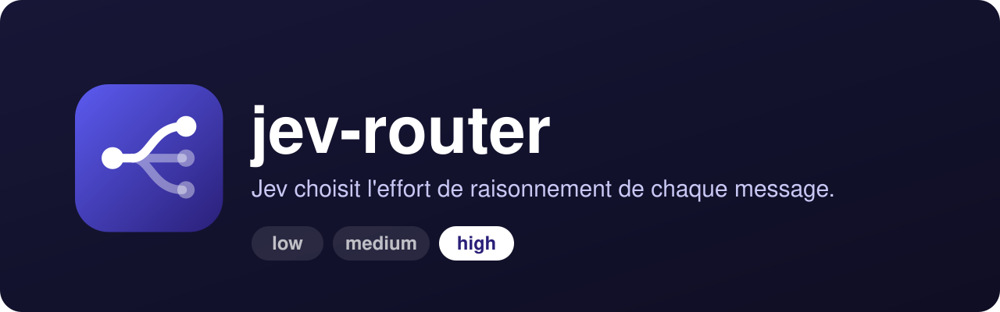
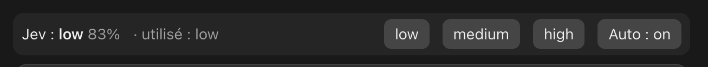
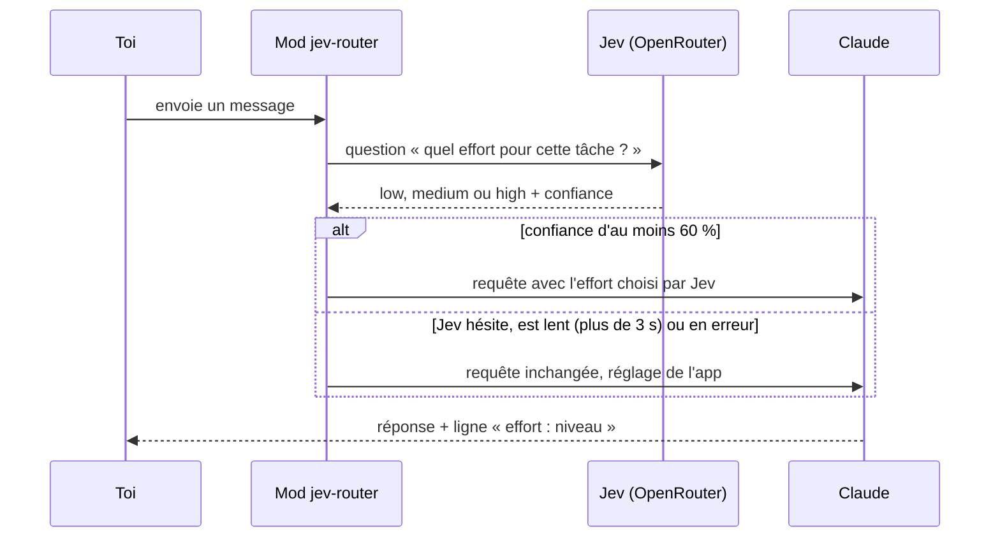

<div align="center">

[](README.en.md)


# jev-router

**Jev choisit l'effort de raisonnement de chaque message que tu envoies à Claude Code.**<br>
Les petites tâches partent en `low`, les grosses en `high`, sans que tu aies à régler l'effort à la main.

[](LICENSE)
[](#installation)
[](hooks/register.tsx)
[](https://openrouter.ai)
[](https://openrouter.ai/typesafe/jev-1.13)

</div>

<p align="center"></p>

<p align="center"></p>

## Pourquoi

L'effort de raisonnement se règle une fois pour toute la session. Trop haut, un « renomme cette variable » coûte autant de réflexion qu'un refactoring complet. Trop bas, le refactoring est bâclé. Et changer de modèle à chaque message n'est pas une option : ça vide le cache de prompt.

jev-router laisse **Jev** (TypeSafe System One, `typesafe/jev-1.13` sur OpenRouter) trancher à ta place, message par message, en gardant le même modèle. Créé avec Claude.

## Comment ça marche



- **Une question par message.** Jev reçoit un `choice` (`low`, `medium`, `high`) : environ 0,5 s et une fraction de centime.
- **Seuil de confiance de 60 %.** En dessous, le réglage d'effort de l'app reste en place.
- **Le modèle ne change jamais.** Un changement de modèle jette le cache de prompt, un changement d'effort le garde.
- **Un bandeau au-dessus du prompt** montre le choix de Jev, sa confiance et l'effort réellement utilisé, avec des boutons pour épingler un effort (`low`, `medium`, `high`), passer Auto sur off, ou désépingler.
- **Une ligne `effort : <niveau>`** s'affiche sous chaque réponse.
- **Ce qui est laissé tranquille** : les sous-agents, les commandes slash et les messages de moins de 8 caractères. Si Jev met plus de 3 s ou échoue, le message part tel quel.

## Installation

```sh
curl -fsSL https://raw.githubusercontent.com/pyxl-dev/jev-router/main/install.sh | sh
```

L'installateur ajoute la marketplace `pyxl-dev/jev-router` à Claude Code, installe le mod, puis vérifie si une clé OpenRouter est déjà dans le Trousseau. Relance-le pour mettre à jour ; `--uninstall` enlève le mod et la marketplace. Il ne touche qu'à ta configuration Claude Code.

Sans le script, trois façons équivalentes :

```sh
# dans Claude Code
/plugin install jev-router --marketplace pyxl-dev/jev-router

# ou depuis un shell
claude plugin marketplace add pyxl-dev/jev-router
claude plugin install jev-router@jev-router
```

Dans l'app de bureau : **+** puis **Plugins**, **Add marketplace** (`pyxl-dev/jev-router`), **Add plugin**.

### Laisse ton agent IA s'en occuper

Colle ceci dans Claude Code, Codex, Cursor ou n'importe quel agent qui a accès à un terminal :

```text
Installe jev-router : https://github.com/pyxl-dev/jev-router
Suis le fichier AGENTS.md de ce dépôt.
```

[`AGENTS.md`](AGENTS.md) explique à l'agent comment l'installer, comment gérer la clé, et les règles de sécurité (ne jamais demander ta clé dans le chat). Il est en anglais, la langue que tous les agents lisent.

### Clé API

Il te faut une clé OpenRouter avec un peu de crédit. Deux façons de la donner :

- dans l'option `OpenRouter API key` du plugin, à l'installation (stockée dans le stockage sécurisé), ou
- sur macOS, option laissée vide, en mettant toi-même la clé dans le Trousseau :

```sh
security add-generic-password -U -a "$USER" -s openrouter-jev -w
```

Sans clé, le mod reste silencieux.

### Prérequis

| | Sert à |
| --- | --- |
| [Claude Code](https://claude.com/claude-code) (CLI ou app de bureau) | héberger le mod |
| Un compte [OpenRouter](https://openrouter.ai) avec du crédit | appeler Jev |
| macOS (facultatif) | lire la clé dans le Trousseau (`openrouter-jev`) |

## Utilisation

Rien à lancer : envoie tes messages comme d'habitude.

- Le bandeau « Jev : `high` 87 % · utilisé : `high` » apparaît au-dessus du prompt. Si la confiance est sous 60 %, il ajoute « (pas sûr) » et l'effort de l'app reste.
- Clique `low`, `medium` ou `high` pour **épingler** un effort : il l'emporte sur Jev jusqu'à ce que tu cliques à nouveau dessus ou sur **Désépingler**.
- **Auto : on / off** active ou coupe les choix de Jev (un effort épinglé reste appliqué).

### Journal des décisions

Chaque message noté par Jev écrit une ligne JSON dans `~/.claude/jev-router/decisions/<AAAA-MM>/<id de session>.jsonl`, à la fin du tour :

- `at`, `prompt` (les 200 premiers caractères)
- `jev` : le choix, la confiance et la latence de Jev (`null` si Jev a échoué ou était trop lent)
- `pinned`, `auto`, `appEffort` (le réglage de l'app) et `effort` (ce qui a vraiment tourné)
- `model`, `inputTokens`, `outputTokens` (réflexion comprise), `durationMs`, `aborted`

Pour voir combien de fois chaque effort a tourné et ce qu'il a coûté en sortie en moyenne :

```sh
cat ~/.claude/jev-router/decisions/*/*.jsonl | jq -s 'group_by(.effort) | map({effort: .[0].effort, turns: length, avgOutput: (map(.outputTokens // 0) | add / length | round)})'
```

Le journal reste sur ta machine.

## Sécurité et confidentialité

- **Chaque prompt envoyé (les 4000 premiers caractères) part chez OpenRouter et TypeSafe pour être noté.** N'utilise pas ce mod dans les sessions où tes prompts doivent rester sur ta machine.
- La clé n'est lue qu'une fois par chargement et n'est jamais affichée.
- Le journal des décisions est local et ne garde que les 200 premiers caractères de chaque prompt.

## Développement

```sh
git clone https://github.com/pyxl-dev/jev-router && cd jev-router
claude plugin marketplace add ./   # ajoute ce clone comme marketplace
claude plugin install jev-router@jev-router
```

Le test du journal (`hooks/log.test.ts`) importe `claude-code/testing`.

| Fichier | |
| --- | --- |
| `hooks/register.tsx` | le mod : appel à Jev, choix de l'effort, bandeau, étiquette sous les réponses, journal |
| `hooks/hooks.json` | déclare le module chargé |
| `hooks/log.test.ts` | test du journal des décisions |
| `types/index.d.ts` | types de l'état du plugin et d'une ligne de journal |
| `.claude-plugin/plugin.json` | manifeste du plugin et option `OpenRouter API key` |
| `.claude-plugin/marketplace.json` | marketplace `pyxl-dev/jev-router` |
| `docs/logo.svg`, `docs/banner.svg` | logo et bannière |
| `docs/screenshot.png` | capture du bandeau |
| `AGENTS.md` | instructions pour n'importe quel agent IA |
| `install.sh` | installateur |

## Licence

[MIT](LICENSE)
